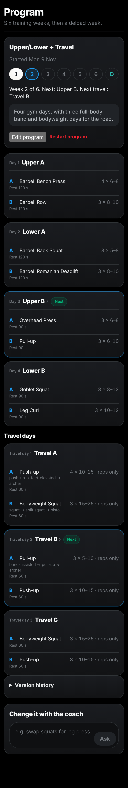
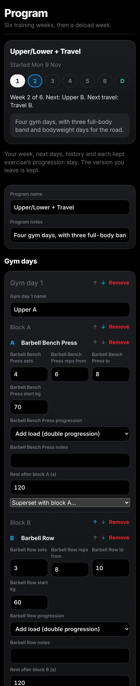
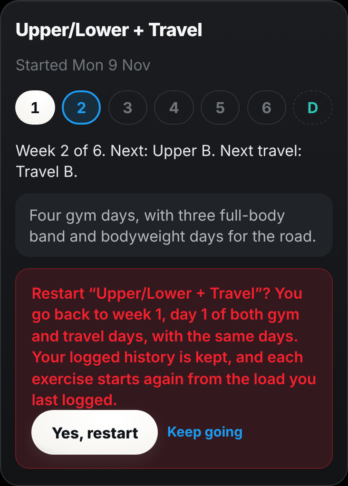
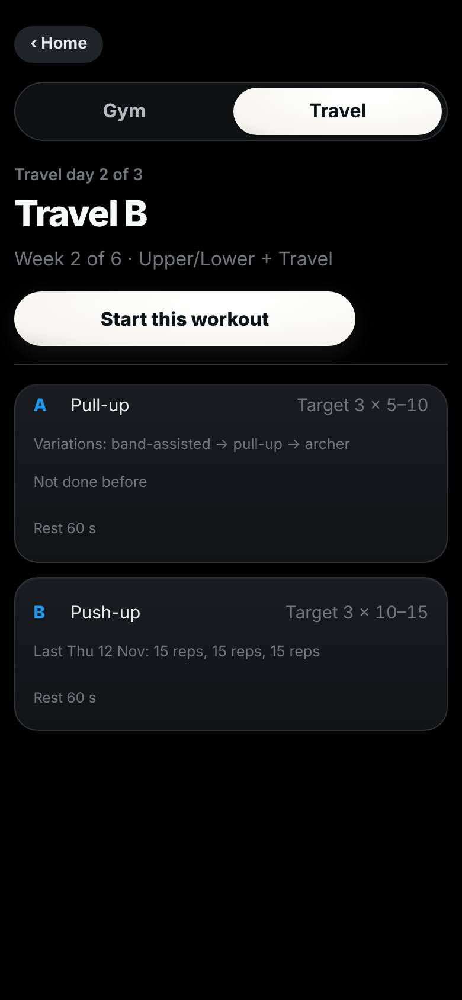

# Programs: travel days, edits and restarts

A program is six training weeks then a deload week (week 7). Its days repeat
every week in order. This page covers the parts beyond that: travel days, how
weeks count, editing the live program, and restarting it.

## Gym and travel days

A program has **gym days** (`days`, at least one) and optionally **travel
days** (`travel_days`, up to seven): a second set for when there is no gym.
Without travel days a program behaves exactly as it always has.

- **Separate rotations.** Each set has its own "next day". A travel session
  does not advance the gym rotation, and the reverse. `GET /api/programs`
  returns `next` (gym) and `next_travel`, each `{week, day}` with `day` counted
  within its set. `GET /api/today` returns `day` and `travel_day`, plus
  `travel_days` (how many) and `training_kind` (which set an unfinished
  workout trains). Starting a workout names a day by its id, so choosing Gym
  or Travel needs no new field.
- **Weeks count calendar weeks** (ISO weeks, Monday start, in UTC) whichever
  set was trained. Training in the same calendar week as the last workout stays
  in its program week; a later calendar week is the next one. A week with no
  training does not use one up. If a set's rotation wraps within one calendar
  week (its first day is already done that week) the day moves to the next
  program week. Without travel days, weeks follow the gym rotation as before.
- **Deload.** Week 7 applies to both sets: about 60% of the sets, to be done at
  RPE 6. After week 7 the block is done.
- **Progression is per exercise slot.** `progression: "load"` (default) is
  double progression by kg. `progression: "reps"` (bodyweight or a band) never
  suggests a kg load: it climbs by reps, and when every set reaches the top of
  the range the target is `advance` (reset to the bottom, take the next
  variation). `variations` is free text for the harder variations or band
  levels, e.g. `push-up -> feet-elevated -> archer`. A `reps` slot cannot have
  `start_load_kg`.

## Versions

Each row of `programs` is one version of a program (`lineage_id`, `version`).
Editing or restarting saves a new version and archives the old one, so a past
workout still points at the version it was done under. `run` counts restarts;
position (week and next days) is worked out from the workouts of one run.
`GET /api/programs/versions` lists the versions of the active program (with
how many workouts each has); `GET /api/programs/{id}` reads an old one.

## Editing the live program

`PUT /api/programs/active` (owner) takes the whole program as it should be:
`name`, `notes`, `days`, `travel_days`. Give an existing day's or exercise's
`id` to keep it; leave it out to add one; leave a day, block or exercise out to
remove it. It saves a new version and keeps:

- the current week and each set's next day (a kept day stays the next day
  wherever it moved; if it was removed, the day in its place is next);
- all logged history;
- each kept exercise's progression and next load, even if it moved or its sets
  and rep range changed.

A **new** exercise starts from the exercise's last logged load if there is one
(never the deload week), otherwise from its `start_load_kg`. It refuses (409)
while a workout of the program is in progress.

The coach uses `propose_program_edit` (`PUT /api/programs/edit-proposal`, same
body). The proposal waits in the app; approving it (`POST
/api/programs/{id}/accept`) applies it as an edit, not a restart. An edit
proposal for a version that has since been replaced is refused (409). A new
proposal (`propose_program`) is unchanged: accepting it starts a new program.

## Restarting

`POST /api/programs/active/restart` (owner, confirmed in the app): the same
days, back to week 1 day 1 of both sets, as a new version in a new run. Logged
history is kept. No progression carries over: each exercise starts from the
last load logged for it (its `start_load_kg` if none), at the bottom of its
range. It refuses (409) while a workout of the program is in progress.

## MCP

| Tool | Change |
| --- | --- |
| `current_program` | returns `travel_days`, `next_travel`, each exercise's `progression`, the active `version`, and whether the proposal is an `edit` |
| `propose_program` | accepts `travel_days`, `progression`, `variations` |
| `propose_program_edit` | new: propose an edit of the live program (ids keep what they name) |
| `record_workout` | `program_day_id` may be a travel day's id; `program_week` is the week of `next` or `next_travel` |
| `record_set` | unchanged (`block_exercise_id` is the exercise's id on that day) |

## Screenshots

| Program | Editing | Restart | Today |
| :---: | :---: | :---: | :---: |
|  |  |  |  |
